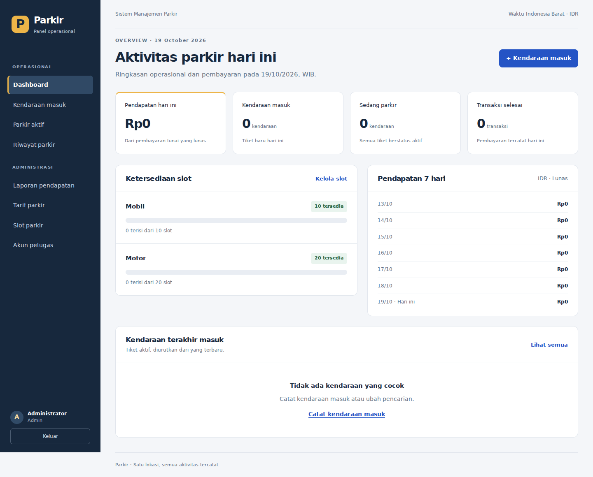

# Sistem Informasi Manajemen Parkir

Aplikasi parkir motor dan mobil berbasis CodeIgniter 4, PHP, MySQL/MariaDB,
dan Bootstrap 5. Dibangun dari rancangan
[ALUR_SISTEM_PARKIR_PBO_CI4.md](docs/ALUR_SISTEM_PARKIR_PBO_CI4.md).
- jangan lupa untuk configurasi di .env nya sama seperti di .htacces pada base url. salin di .env.example ke -> .env

Untuk XAMPP Windows dan gejala **Index of /...**, ikuti
[panduan XAMPP](docs/XAMPP.md). Aplikasi berada di `public/index.php`.
Root proyek mengarahkan browser ke `public/` secara otomatis.
Dependensi runtime sudah disertakan dalam `vendor`, sehingga aplikasi dapat
dijalankan tanpa memasang atau menjalankan Composer.

## Fitur

- Halaman profil publik dengan navigasi Tentang, Keunggulan, Alur parkir, dan FAQ.
- Tombol Masuk serta Daftar di navigasi atas, termasuk tampilan HP.
- Pendaftaran dan area pengguna terpisah dengan kendaraan, tiket, tagihan, riwayat, dan profil.
- Pengajuan masuk oleh pengguna, antrean verifikasi petugas, serta permintaan keluar.
- Riwayat dan bukti bayar pribadi, terhubung ke akun pengaju.
- Login pengguna, admin, dan petugas dengan pembatasan akses sesuai peran.
- Satu database dan satu file `app/Database/parkir.sql` untuk seluruh peran.
- Kendaraan masuk, alokasi slot otomatis, dan tiket yang dapat dicetak.
- Cari tiket aktif melalui kode atau plat, dilengkapi filter dan pagination.
- Tarif motor per jam dan mobil bertingkat. Minimal satu jam, pembulatan ke atas.
- Snapshot tarif saat masuk agar perubahan tarif tidak mengubah kunjungan lama.
- Pembayaran tunai, perhitungan kembalian, dan bukti pembayaran.
- Dashboard, riwayat, laporan harian/bulanan, filter tanggal, dan ekspor CSV.
- Pengaturan tarif, tambah/edit/nonaktifkan slot, hapus slot tanpa riwayat.
- Tambah/edit/nonaktifkan petugas dan ganti password petugas.
- Bootstrap disimpan lokal. CSS dan JavaScript aplikasi memakai berkas terpisah.



Screenshot memakai data lokal pengujian. Instalasi awal hanya berisi slot, tarif,
dan akun admin yang disiapkan sendiri.

## Persyaratan

- PHP 8.2 atau lebih baru, 64 bit. Pengujian lokal memakai PHP 8.3.
- Ekstensi PHP: intl, mbstring, mysqli. Pengujian juga memerlukan dom, xml,
  xmlwriter serta fungsi proc_open untuk skenario konkurensi.
- MySQL 8.0.16+ atau MariaDB 10.4+ dengan InnoDB.
- Server Apache/Nginx dengan document root di direktori `public`.

Composer hanya diperlukan pengembang untuk memperbarui dependensi atau memasang
PHPUnit. Pengguna XAMPP dapat langsung memakai hasil clone atau Download ZIP.

## Menjalankan lokal

1. Clone repository lengkap, atau pilih **Code > Download ZIP** di GitHub lalu
   ekstrak seluruh isinya, termasuk `vendor`.

   ```bash
   git clone https://github.com/abdullahazwar/framework-codeigniter-parkirkendaraan.git
   cd framework-codeigniter-parkirkendaraan
   ```

2. Salin konfigurasi contoh.

   ```bash
   cp .env.example .env
   ```

   Pada Command Prompt Windows:

   ```bat
   copy .env.example .env
   ```

   Untuk Apache XAMPP, gunakan `.env.xampp.example` sebagai contoh dan ikuti
   [panduan XAMPP](docs/XAMPP.md) agar alamat subfolder sesuai.

3. Buat database kosong melalui MySQL atau phpMyAdmin.

   ```sql
   CREATE DATABASE parkir
     CHARACTER SET utf8mb4 COLLATE utf8mb4_unicode_ci;
   ```

4. Edit `.env`: isi host, port, database, username, dan password database.
   Atur `app.baseURL` sesuai alamat yang akan dibuka. Contoh lokal:
   `http://localhost:8080/`.

5. Isi `parkir.adminUsername` dan `parkir.adminPassword`. Password harus unik,
   sepanjang 12 sampai 72 karakter. Tidak ada password bawaan yang dapat dipakai.

6. Jalankan migration dan seed.

   ```bash
   php spark migrate
   php spark db:seed InitialSeeder
   ```

   Seed membuat 20 slot motor, 10 slot mobil, tarif awal, dan akun admin.
   Seed tidak menimpa tarif atau password admin yang sudah ada. Hapus nilai
   `parkir.adminPassword` dari `.env` setelah seed berhasil.

   Alternatif melalui phpMyAdmin: pilih database lalu impor
   [`app/Database/parkir.sql`](app/Database/parkir.sql). File ini menyiapkan seluruh
   tabel, 30 slot, tarif awal, dan data admin dari dump awal proyek jika seluruh
   tabel aplikasi masih kosong. Jalur SQL tidak memerlukan migration atau seed.
   Untuk membuat admin dengan password yang ditentukan sendiri pada instalasi
   kosong, gunakan jalur migration dan seed di atas.

7. Mulai server lokal.

   ```bash
   php spark serve
   ```

   Buka `http://localhost:8080`, lalu login dengan akun yang disiapkan pada langkah 5.

## Cara menggunakan

Halaman awal menampilkan profil web. Pengunjung dapat membaca informasi tanpa
login, membuka **Daftar**, lalu masuk ke **Area pengguna** pada `/pengguna`.
Akun hasil pendaftaran selalu berperan `pengguna`. Panel operasional tersedia
untuk admin dan petugas pada `/dashboard`.

### Alur pengguna parkir

1. Buka **Kendaraan**, simpan plat nomor dan jenis kendaraan.
2. Saat sudah tiba di pintu masuk, buka **Parkir saya**, pilih kendaraan,
   centang konfirmasi kedatangan, dan ajukan masuk.
3. Tunjukkan kode permintaan kepada petugas. Petugas mencocokkan kendaraan lalu
   mengonfirmasi masuk melalui **Permintaan pengguna**.
4. Buka detail parkir untuk melihat tiket, area/slot, waktu masuk, dan estimasi tagihan.
5. Saat akan keluar, pilih **Minta keluar & bayar tunai**, lalu bayar kepada petugas.
6. Setelah petugas mengonfirmasi pembayaran, tiket selesai dan bukti bayar dapat
   dibuka atau dicetak melalui **Riwayat**.

Pengajuan belum memesan slot atau memulai biaya. Slot dan tarif ditetapkan saat
petugas mengonfirmasi masuk. Permintaan yang belum diterima dapat dibatalkan;
penolakan petugas menampilkan alasannya. Estimasi biaya tetap berjalan sampai
pembayaran diselesaikan petugas.

Satu kendaraan hanya dapat disimpan oleh satu akun. Melepas kendaraan tidak
menghapus riwayat akun lama. Tiket manual yang pernah memakai plat sama tidak
otomatis menjadi riwayat akun baru.

### Pembaruan instalasi yang sudah berjalan

Setelah mengambil source terbaru, pilih database aplikasi di phpMyAdmin,
kemudian buka **Import** dan pilih
[`app/Database/parkir.sql`](app/Database/parkir.sql).
Ini satu-satunya file SQL aplikasi, untuk instalasi baru maupun database lama.
Halaman admin, petugas, dan pengguna memakai tabel yang saling terhubung dalam
database yang sama. Tampilan yang berbeda tidak membutuhkan file SQL terpisah.

Pada database lama, SQL menambah peran `pengguna` dan tabel fitur yang belum ada.
Akun beserta passwordnya, kendaraan, tarif, slot, tiket, dan pembayaran lama tetap
tersimpan. Data awal tidak dimasukkan ulang pada database yang sudah berisi data.
File ini boleh diimpor ulang.

Mengambil source terbaru tidak otomatis mengubah tabel database lokal. Jika kolom
`role` masih hanya menerima `admin` dan `petugas`, pendaftaran pengguna akan gagal
meskipun data formulir sudah valid. Impor `parkir.sql` yang terbaru untuk
memperbaikinya sekaligus mengaktifkan fitur pengguna.

Alternatif melalui terminal dari folder proyek:

```bash
php spark migrate
```

Pada XAMPP Windows jika PHP belum ada di PATH:

```bat
C:\xampp\php\php.exe spark migrate
```

Pilih salah satu cara: impor `parkir.sql` atau jalankan migration.
Tidak perlu menjalankan seed lagi atau memasang Composer untuk pembaruan.
Pertahankan `.env` dan seluruh `.htaccess` yang sudah sesuai localhost.

### Operasional admin dan petugas

1. Admin membuka Akun petugas untuk menambahkan akun operasional.
2. Untuk pengajuan dari akun pengguna, buka **Permintaan pengguna**, cocokkan
   plat dan kode, lalu konfirmasi masuk. Permintaan yang tidak sesuai dapat ditolak
   dengan alasan. Untuk kendaraan tanpa pengajuan, gunakan **Kendaraan masuk**.
3. Cetak tiket melalui dialog browser atau catat kode tiketnya.
4. Saat kendaraan keluar, buka tab **Minta keluar** di Permintaan pengguna,
   atau buka Parkir aktif dan cari plat/kode tiket.
5. Pilih Proses keluar, periksa tagihan, lalu isi uang tunai diterima.
6. Centang bahwa pembayaran sudah diterima, lalu konfirmasi.
7. Cetak bukti dan periksa transaksi melalui Riwayat atau Laporan pendapatan.

Jika durasi melewati batas jam saat layar pembayaran masih terbuka, aplikasi
meminta peninjauan ulang tagihan. Pembayaran yang sudah selesai tidak dapat
diproses dua kali.

## Tarif contoh

| Kendaraan | Jam pertama | Jam berikutnya | Contoh 2 jam 15 menit |
| --- | ---: | ---: | ---: |
| Motor | Rp3.000 | Rp3.000 | Rp9.000 |
| Mobil | Rp5.000 | Rp3.000 | Rp11.000 |

Seluruh nominal memakai integer rupiah. Semua waktu memakai Asia/Jakarta.
Plat dinormalisasi menjadi huruf kapital tanpa spasi. Format MVP mendukung plat
umum 1 sampai 2 huruf, 1 sampai 4 angka, serta maksimal 3 huruf belakang.

## Struktur

```text
app/
  Config/        Route, database, session, filter, keamanan
  Controllers/   Penanganan request
  Database/      Migration dan InitialSeeder
  Entities/      Kendaraan dan TiketParkir
  Exceptions/    Kesalahan aturan parkir
  Filters/       Autentikasi dan akses admin, petugas, pengguna
  Helpers/       Format uang, waktu, dan navigasi
  Models/        Enam model tabel
  Services/      ParkirService, PenggunaParkirService, LaporanService, tarif PBO
  Views/         HTML dan penyajian data
public/assets/
  css/           Seluruh gaya aplikasi
  js/            Interaksi form, pembayaran, cetak
  vendor/        Bootstrap 5.3.8 lokal dan lisensinya
tests/
  unit/          Tarif dan normalisasi plat
  integration/   Transaksi, snapshot, laporan, konkurensi
  feature/       Login wajib, izin admin, sesi, CSRF
docs/            Alur, arsitektur, panduan tes, screenshot
vendor/          CodeIgniter, Laminas Escaper, PSR Log, autoloader dan lisensi
```

Penerapan PBO dan diagram class tersedia di [ARSITEKTUR.md](docs/ARSITEKTUR.md).

## Pengujian

Periksa kelengkapan runtime tanpa Composer:

```bash
php scripts/check-runtime.php
php scripts/lint.php
```

Untuk mengembangkan aplikasi dan menjalankan PHPUnit, pasang Composer 2 dan
jalankan `composer install`. Langkah ini hanya untuk pengembangan; dependensi
runtime untuk XAMPP sudah tersedia dalam repository.

Buat database terpisah yang namanya berakhir dengan `_test`. Contoh:

```sql
CREATE DATABASE parkir_test
  CHARACTER SET utf8mb4 COLLATE utf8mb4_unicode_ci;
```

Isi `database.tests.*` di `.env`. Gunakan database khusus pengujian karena suite
melakukan migration ulang dan menghapus fixture. Database tes wajib berbeda dari
database aplikasi. Akun tes perlu izin DDL dan CREATE TRIGGER untuk uji rollback.

```bash
composer validate --strict
composer lint
composer test
composer audit
```

Suite memakai MySQL/MariaDB sungguhan. Uji konkurensi menjalankan dua proses PHP
dengan koneksi terpisah dan barrier, termasuk perebutan slot terakhir,
pembayaran tiket yang sama, pengajuan/verifikasi ganda, dan pembatalan bersamaan.
CI GitHub mengonfigurasi matriks MySQL 8.0 dan MariaDB
10.11 serta 10.4 dengan PHP 8.2. Bukti pengujian lokal dan cakupannya ada di
[PENGUJIAN.md](docs/PENGUJIAN.md).

## Pemasangan server

1. Salin repository lengkap, termasuk `vendor`, dan jalankan
   `php scripts/check-runtime.php`. Gunakan bundle runtime dari repository bersih
   jika sebelumnya memasang paket pengembangan.
2. Isi `.env` server sendiri. Jangan memasukkan `.env` ke Git.
3. Set `CI_ENVIRONMENT = production`, `app.baseURL` ke alamat HTTPS, serta
   `app.forceGlobalSecureRequests = true` dan `Cookie.secure = true`.
4. Arahkan document root ke `public`. Jangan membuka root proyek sebagai web root.
5. Berikan izin tulis hanya pada `writable` sesuai pengguna PHP.
6. Jalankan migration dan seed awal dengan akun database yang punya izin DDL.
   Akun runtime sesudah instalasi cukup mendapat SELECT, INSERT, UPDATE, DELETE.
7. Gunakan backup database dan simpan direktori session/log di luar Git.

Proyek ini dikirim sebagai source code. Tidak ada deployment server publik yang
dilakukan oleh proses pembuatan repository ini. MVP mencakup satu lokasi,
motor/mobil, dan tunai. QRIS, kamera, palang, serta printer khusus berada di luar MVP.

## Lisensi

Source aplikasi memakai MIT. Hak cipta appstarter CodeIgniter dipertahankan dalam
`LICENSE`. Lisensi Bootstrap ada di `public/assets/vendor/bootstrap/LICENSE`.
Daftar versi dan lisensi dependensi bawaan ada di [DEPENDENSI.md](docs/DEPENDENSI.md).
