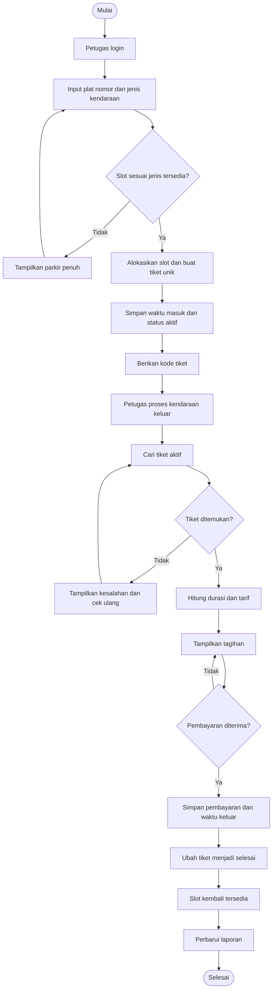
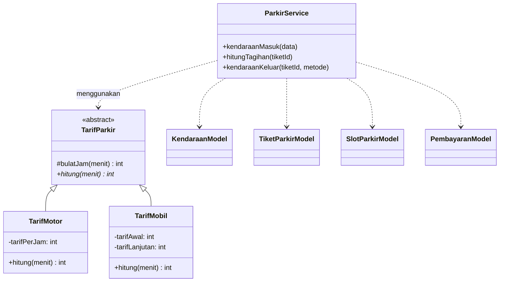
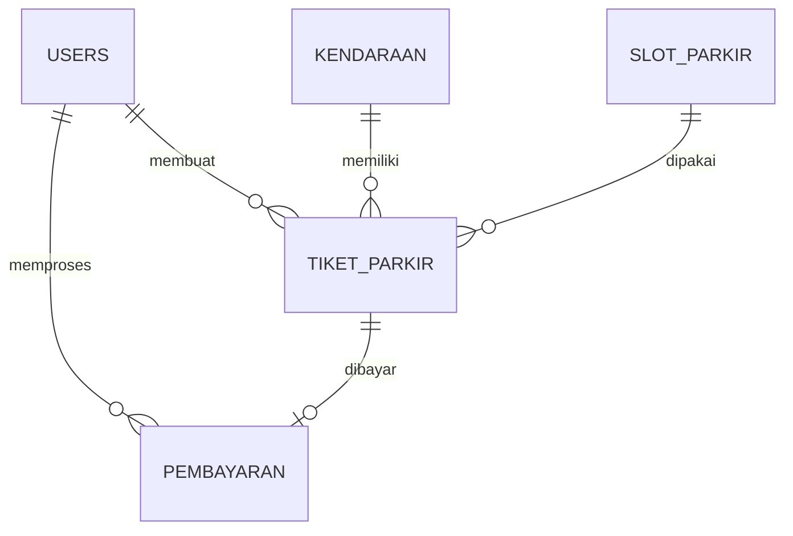
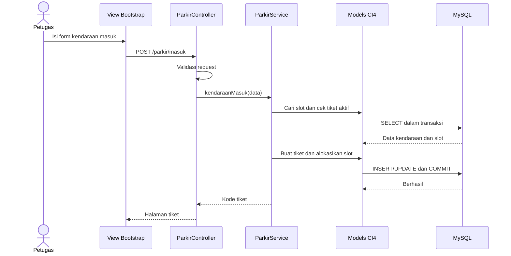

# ALUR PENGEMBANGAN SISTEM PARKIR BERBASIS PBO

**Proyek:** Sistem Informasi Manajemen Parkir
**Framework:** CodeIgniter 4
**Bahasa:** PHP
**Arsitektur:** MVC dan Pemrograman Berorientasi Objek (PBO/OOP)
**Database:** MySQL/MariaDB
**Antarmuka:** HTML, Bootstrap 5, CSS, JavaScript terpisah
**Status:** MVP telah diimplementasikan di repository ini. Bukti pengujian lokal tercatat pada `PENGUJIAN.md`. Pemasangan server publik belum dilakukan.

---

## 1. Deskripsi dan ruang lingkup

Sistem web untuk mencatat kendaraan masuk dan keluar, mengatur kapasitas parkir, menghitung tarif secara otomatis, menyimpan pembayaran, dan menyajikan laporan.

**Cakupan versi pertama (MVP):**
- Kendaraan **motor** dan **mobil**.
- Satu lokasi parkir dengan slot terdaftar.
- Peran **admin** dan **petugas**.
- Pembayaran **tunai** dan status lunas.
- Tarif berbasis jam dengan pembulatan ke atas.
- Riwayat transaksi dan laporan harian/bulanan.

**Di luar MVP:** QRIS, kamera pembaca plat, palang otomatis, multi-cabang, integrasi printer khusus.

## 2. Permasalahan dan tujuan

| Masalah | Solusi yang dibangun |
|---|---|
| Pencatatan manual | Tiket masuk dan keluar secara digital |
| Salah hitung biaya | Perhitungan tarif melalui class PBO |
| Slot tidak terpantau | Alokasi slot dan daftar slot aktif |
| Riwayat sulit dicari | Pencarian tiket dan plat nomor |
| Laporan manual | Rekap transaksi berdasarkan waktu |

## 3. Aktor dan hak akses

| Fitur | Admin | Petugas |
|---|:---:|:---:|
| Login dan logout | Ya | Ya |
| Dashboard | Ya | Ya |
| Kendaraan masuk/keluar | Ya | Ya |
| Kelola tarif | Ya | Tidak |
| Kelola slot | Ya | Tidak |
| Kelola akun petugas | Ya | Tidak |
| Laporan dan ekspor | Ya | Sesuai izin |
| Riwayat parkir | Ya | Ya |

**Keamanan:** password di-hash; sesi login aman; route admin wajib dilindungi filter otorisasi; input divalidasi; operasi POST dilindungi CSRF; query memakai Query Builder/parameter binding.

## 4. Alur utama sistem



### 4.1 Kendaraan masuk

1. Petugas login dan membuka formulir **Kendaraan Masuk**.
2. Petugas mengisi plat nomor serta jenis kendaraan.
3. Sistem memvalidasi input dan memastikan plat tersebut tidak memiliki tiket aktif.
4. Sistem mencari slot kosong yang cocok dengan jenis kendaraan.
5. Di dalam transaksi database, sistem mengunci/memverifikasi alokasi slot supaya tidak ditempati dua kendaraan sekaligus.
6. Sistem membuat kode tiket unik, mencatat `waktu_masuk` dari server, menyimpan status `aktif`, dan mengaitkannya ke slot.
7. Sistem menampilkan tiket yang dapat dicetak atau dicatat.
8. Jika slot penuh, tidak ada tiket baru yang dibuat.

### 4.2 Kendaraan keluar

1. Petugas memasukkan kode tiket atau mencari plat nomor.
2. Sistem mengambil tiket dengan status `aktif`.
3. Sistem menghitung durasi dari waktu server dan menerapkan aturan tarif sesuai jenis kendaraan.
4. Petugas meninjau total tagihan dan mengonfirmasi penerimaan pembayaran.
5. Dalam **satu transaksi database**, sistem membuat data pembayaran, mengisi `waktu_keluar`, mengubah tiket ke status `selesai`, lalu melepaskan slot.
6. Sistem menampilkan bukti pembayaran dan memperbarui dashboard.
7. Proses keluar pada tiket yang sudah selesai harus ditolak agar pembayaran tidak ganda.

### 4.3 Aturan perhitungan

Contoh tarif untuk tugas, dapat diubah admin:
- **Motor:** Rp3.000 per jam.
- **Mobil:** Rp5.000 untuk jam pertama, Rp3.000 tiap jam berikutnya.
- Durasi positif kurang dari satu jam dihitung satu jam; jam berikutnya dibulatkan ke atas.
- Durasi nol ditetapkan minimal satu jam sesuai kebijakan contoh.
- Nilai tarif yang berlaku saat tiket dibuat/ditagihkan harus disimpan sebagai snapshot transaksi, sehingga histori tidak berubah saat tarif diedit.

**Contoh:** motor 2 jam 15 menit = 3 × Rp3.000 = **Rp9.000**; mobil 2 jam 15 menit = Rp5.000 + 2 × Rp3.000 = **Rp11.000**.

## 5. Konsep PBO yang diterapkan

| Prinsip | Implementasi | Bukti dalam kode |
|---|---|---|
| Encapsulation | Nilai tarif sebagai properti `private`/`protected` | Diakses melalui constructor/method, bukan variabel global |
| Inheritance | `TarifMotor` dan `TarifMobil` mewarisi `TarifParkir` | `extends TarifParkir` |
| Polymorphism | Cara menghitung tarif berubah menurut jenis kendaraan | Implementasi `hitung()` pada subclass |
| Abstraction | Kontrak dasar untuk semua jenis tarif | `abstract class TarifParkir` dan `abstract hitung()` |

### 5.1 Diagram class sederhana



### 5.2 Contoh kode konsep PBO

Simpan dalam **tiga file berbeda** sesuai nama class pada direktori `app/Services/Tarif/`.

**`TarifParkir.php`**

```php
<?php
namespace App\Services\Tarif;

use InvalidArgumentException;

abstract class TarifParkir
{
    protected function bulatJam(int $menit): int
    {
        if ($menit < 0) {
            throw new InvalidArgumentException('Durasi tidak valid');
        }

        return max(1, intdiv($menit + 59, 60));
    }

    abstract public function hitung(int $menit): int;
}
```

**`TarifMotor.php`**

```php
<?php
namespace App\Services\Tarif;

final class TarifMotor extends TarifParkir
{
    public function __construct(private int $tarifPerJam) {}

    public function hitung(int $menit): int
    {
        return $this->bulatJam($menit) * $this->tarifPerJam;
    }
}
```

**`TarifMobil.php`**

```php
<?php
namespace App\Services\Tarif;

final class TarifMobil extends TarifParkir
{
    public function __construct(
        private int $tarifAwal,
        private int $tarifLanjutan
    ) {}

    public function hitung(int $menit): int
    {
        $jam = $this->bulatJam($menit);
        return $this->tarifAwal + ($jam - 1) * $this->tarifLanjutan;
    }
}
```

Catatan: validasi tarif harus menolak nilai negatif saat konfigurasi dan konstruksi objek. Semua durasi dihitung menggunakan tanggal/waktu server di zona waktu aplikasi yang konsisten.

## 6. Model data

### 6.1 Tabel utama

| Tabel | Field inti | Keterangan |
|---|---|---|
| `users` | `id`, `nama`, `username`, `password_hash`, `role`, `aktif` | Login dan hak akses |
| `kendaraan` | `id`, `plat_nomor`, `jenis` | Master kendaraan |
| `slot_parkir` | `id`, `kode_slot`, `area`, `jenis`, `aktif` | Master slot, jenis motor/mobil |
| `tarif` | `id`, `jenis`, `tarif_awal`, `tarif_lanjutan`, `updated_at` | Tarif terkini |
| `tiket_parkir` | `id`, `kode_tiket`, `kendaraan_id`, `slot_id`, `petugas_masuk_id`, `waktu_masuk`, `waktu_keluar`, `status`, `tarif_awal_snapshot`, `tarif_lanjutan_snapshot` | Catatan kunjungan parkir |
| `pembayaran` | `id`, `tiket_id`, `petugas_id`, `durasi_menit`, `total`, `metode`, `waktu_bayar` | Pembayaran yang diselesaikan |

**Aturan relasi:**
- `kendaraan.id` → banyak `tiket_parkir.kendaraan_id`.
- `slot_parkir.id` → banyak `tiket_parkir.slot_id` sepanjang waktu, tetapi maksimal satu tiket aktif pada suatu saat.
- `tiket_parkir.id` → maksimal satu `pembayaran.tiket_id` dengan unique index.
- `users.id` → banyak tiket masuk dan pembayaran.

**Aturan integritas:**
- `kode_tiket` harus unik.
- `kode_slot` harus unik per area.
- `pembayaran.tiket_id` harus unik, untuk mencegah pembayaran berulang.
- Pastikan maksimal satu tiket aktif per slot dan per plat nomor melalui logika transaksi, penguncian row, dan kontrol konkurensi yang diuji. Tidak cukup hanya mengandalkan pengecekan sebelum `INSERT`.
- Simpan rupiah sebagai bilangan bulat (misal `BIGINT`) untuk menghindari kesalahan pecahan uang.
- Semua waktu yang disimpan dan ditampilkan menggunakan kebijakan zona waktu yang konsisten, misalnya Asia/Jakarta.

### 6.2 Diagram hubungan tabel



## 7. Struktur direktori proyek

```text
parkir-pbo/
├── app/
│   ├── Config/
│   │   ├── Routes.php
│   │   └── Filters.php
│   ├── Controllers/
│   │   ├── AuthController.php
│   │   ├── DashboardController.php
│   │   ├── ParkirController.php
│   │   ├── TarifController.php
│   │   ├── SlotController.php
│   │   └── LaporanController.php
│   ├── Models/
│   │   ├── UserModel.php
│   │   ├── KendaraanModel.php
│   │   ├── SlotParkirModel.php
│   │   ├── TarifModel.php
│   │   ├── TiketParkirModel.php
│   │   └── PembayaranModel.php
│   ├── Entities/
│   │   ├── Kendaraan.php
│   │   └── TiketParkir.php
│   ├── Services/
│   │   ├── ParkirService.php
│   │   └── Tarif/
│   │       ├── TarifParkir.php
│   │       ├── TarifMotor.php
│   │       └── TarifMobil.php
│   ├── Filters/
│   │   ├── AuthFilter.php
│   │   └── AdminFilter.php
│   ├── Database/
│   │   ├── Migrations/
│   │   └── Seeds/
│   └── Views/
│       ├── layouts/
│       ├── auth/
│       ├── dashboard/
│       ├── parkir/
│       ├── tarif/
│       ├── slot/
│       └── laporan/
├── public/
│   └── assets/
│       ├── css/
│       │   └── style.css
│       └── js/
│           └── parkir.js
├── tests/
├── writable/
└── .env.example (salin menjadi .env lokal)
```

Prinsip struktur: **Controller** menangani HTTP; **Service** menangani proses bisnis; **Model** menangani database; **Entity** merepresentasikan data; **View** fokus pada tampilan; CSS/JS tidak dicampur ke file logika utama.

## 8. Rancangan endpoint dan halaman

| Method | URL | Akses | Tujuan |
|---|---|---|---|
| GET | `/login` | Publik | Form login |
| POST | `/login` | Publik | Memproses login |
| POST | `/logout` | Login | Logout |
| GET | `/dashboard` | Login | Statistik operasional |
| GET | `/parkir/masuk` | Login | Form kendaraan masuk |
| POST | `/parkir/masuk` | Login | Membuat tiket |
| GET | `/parkir/aktif` | Login | Daftar kendaraan aktif |
| GET | `/parkir/keluar/{id}` | Login | Detail tagihan |
| POST | `/parkir/keluar/{id}` | Login | Konfirmasi pembayaran/keluar |
| GET | `/riwayat` | Login | Riwayat transaksi |
| GET | `/admin/tarif` | Admin | Pengaturan tarif |
| GET | `/admin/slot` | Admin | Kelola slot |
| GET | `/admin/petugas` | Admin | Kelola petugas |
| GET | `/admin/laporan` | Admin | Laporan pendapatan |

Gunakan named routes, filter login/role, validasi request, dan CSRF untuk operasi yang mengubah data.

## 9. Mekanisme MVC



## 10. Tahapan pengerjaan proyek

### Tahap 1. Persiapan
- [x] Pasang PHP dan ekstensi yang diperlukan sesuai persyaratan versi CI4 yang dipilih.
- [x] Instal Composer dan MySQL/MariaDB.
- [x] Jalankan `composer create-project codeigniter4/appstarter parkir-pbo`.
- [x] Salin `env` menjadi `.env`, atur `CI_ENVIRONMENT = development` untuk lokal.
- [x] Konfigurasikan database dan zona waktu.

### Tahap 2. Database
- [x] Buat migration enam tabel inti.
- [x] Buat foreign key, indeks, constraint unik yang relevan.
- [x] Buat seeder slot awal, tarif motor/mobil, serta akun admin yang password-nya di-hash.
- [x] Uji migration `php spark migrate`.

### Tahap 3. Penerapan PBO
- [x] Buat abstract class `TarifParkir`.
- [x] Buat `TarifMotor` dan `TarifMobil`.
- [x] Buat Entity dan Model sesuai tabel.
- [x] Buat `ParkirService` dengan dependency koneksi database yang jelas.
- [x] Buat unit test untuk perhitungan tiap jenis tarif.

### Tahap 4. Autentikasi dan otorisasi
- [x] Implementasikan login/logout dan session.
- [x] Tambahkan `AuthFilter` dan `AdminFilter`.
- [x] Uji akses ilegal ke route admin.

### Tahap 5. Operasional parkir
- [x] Form kendaraan masuk dan tiket unik.
- [x] Cek ketersediaan slot dan cegah duplikasi plat aktif.
- [x] Detail kendaraan keluar dan estimasi tagihan.
- [x] Konfirmasi pembayaran atomik dan pelepasan slot.
- [x] Penanganan error/tiket tidak ditemukan.

### Tahap 6. Antarmuka dan laporan
- [x] Dashboard ringkasan.
- [x] Daftar tiket aktif dan riwayat.
- [x] Pengaturan slot, tarif, dan petugas (admin).
- [x] Laporan pendapatan harian dan bulanan.
- [x] Desain responsif Bootstrap 5 dengan CSS/JS terpisah.

### Tahap 7. Pengujian dan dokumentasi
- [x] Uji semua alur utama dan akses berdasarkan peran.
- [x] Uji tarif pada batas 1, 60, 61, 120, 121 menit.
- [x] Uji slot penuh dan dua petugas bersamaan.
- [x] Uji tiket keluar diproses dua kali.
- [x] Uji perubahan tarif tidak mengubah histori pembayaran.
- [x] Uji laporan sesuai transaksi yang berhasil dibayar.
- [x] Buat dokumentasi penggunaan, diagram UML, dan screenshot halaman.

## 11. Skenario pengujian minimum

| Skenario | Hasil yang diharapkan |
|---|---|
| Motor masuk saat slot ada | Tiket aktif dibuat dan slot digunakan |
| Motor masuk saat penuh | Ditolak tanpa menyimpan tiket |
| Plat nomor sama sudah aktif | Ditolak atau diarahkan ke tiket aktif |
| Motor 135 menit pada Rp3.000/jam | Tagihan Rp9.000 |
| Mobil 135 menit tarif contoh | Tagihan Rp11.000 |
| Pembayaran terkonfirmasi | Satu pembayaran, tiket selesai, slot kosong |
| Petugas memproses tiket selesai | Ditolak, tidak membuat pembayaran baru |
| Petugas membuka halaman tarif admin | Akses ditolak |
| Tarif diubah setelah transaksi selesai | Nilai transaksi historis tetap |
| Dua petugas memilih slot sama bersamaan | Hanya satu yang berhasil menggunakan slot |

## 12. Kriteria proyek dinyatakan selesai

- [x] Login admin dan petugas berfungsi.
- [x] Kendaraan masuk/keluar dan alokasi slot berfungsi.
- [x] Tarif motor/mobil sesuai contoh dan dapat diubah admin.
- [x] Keempat konsep PBO dapat ditunjukkan pada kode dan diagram class.
- [x] Data tercatat dalam MySQL secara konsisten tanpa pembayaran ganda.
- [x] Dashboard, riwayat, dan laporan cocok dengan database.
- [x] Semua skenario pengujian minimum lulus.

---

**Catatan kelanjutan:** Dokumen ini merupakan acuan utama implementasi. Kerjakan bertahap sesuai checklist dan jangan menganggap tahap selesai sebelum diuji. Jika ada perubahan fitur atau struktur database, perbarui dokumen ini supaya alur dan kode tetap selaras.


## 13. Implementasi di repository

- Enam tabel inti dibuat melalui migration MySQL/MariaDB dengan InnoDB.
- Generated column dan unique index menjaga satu plat serta satu slot aktif.
- ParkirService memakai koneksi yang dapat diinjeksi, row lock, transaksi atomik,
  dan retry konflik yang terbatas.
- Snapshot tarif dibuat saat kendaraan masuk.
- Pembayaran tunai mencatat uang diterima dan kembalian.
- Tarif yang berubah saat layar pembayaran terbuka memerlukan peninjauan ulang.
- InitialSeeder memerlukan password admin dari environment. Tidak ada password
  bawaan di source. Instalasi server lokal pengguna tetap perlu dilakukan sendiri.
- Slot yang pernah digunakan dipertahankan untuk riwayat. Slot kosong tanpa riwayat
  dapat dihapus. Slot yang sedang terisi tidak dapat diubah.
- Akun petugas dapat dibuat, diedit, dinonaktifkan, dan diganti password.
- Laporan harian dan bulanan, ringkasan, serta CSV mengikuti filter tanggal yang sama.
- CSS/JavaScript dan Bootstrap lokal berada di public/assets.
- Lihat README.md untuk instalasi, ARSITEKTUR.md untuk PBO dan integritas data,
  serta PENGUJIAN.md untuk hasil pengujian dan batas pemeriksaan.
- Checklist di atas merujuk pekerjaan implementasi dan pengujian lokal di
  lingkungan pengembang. Bukan bukti bahwa aplikasi sudah terpasang pada server publik.
