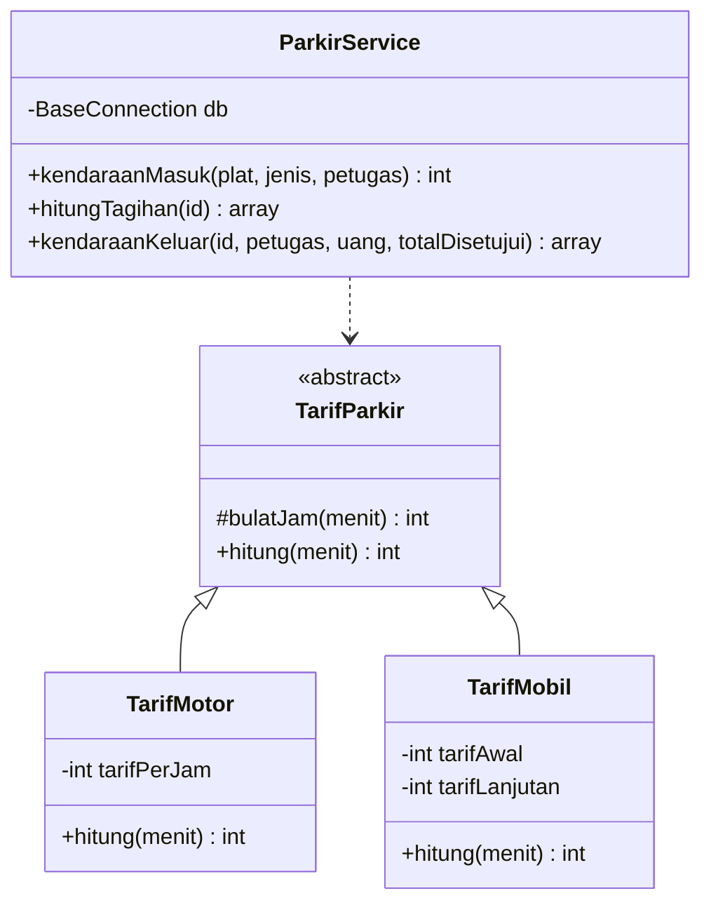
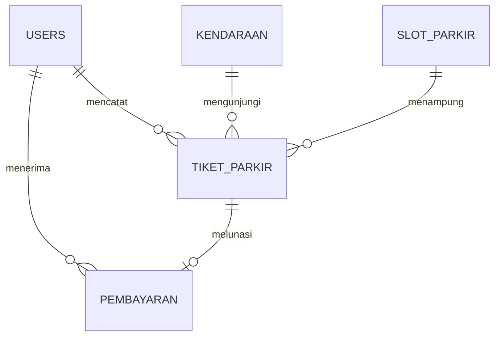

# Arsitektur dan penerapan PBO

## Pemisahan tanggung jawab

| Lapisan | Lokasi | Tanggung jawab |
| --- | --- | --- |
| Route dan filter | `app/Config`, `app/Filters` | Method HTTP, login, izin admin, CSRF |
| Controller | `app/Controllers` | Input HTTP, validasi, redirect, data halaman |
| Service | `app/Services` | Aturan parkir, transaksi atomik, perhitungan, laporan |
| Model | `app/Models` | Pemetaan tabel melalui Model CodeIgniter |
| Entity | `app/Entities` | Normalisasi plat dan representasi tiket |
| View | `app/Views` | Markup HTML dan penyajian data |
| Aset | `public/assets` | CSS, JavaScript, Bootstrap lokal |

`ParkirService` menerima koneksi database melalui constructor. Query dengan row
lock berada di service agar seluruh alur memakai transaksi dan koneksi yang sama.
Model tetap tersedia untuk setiap tabel. Tidak ada perubahan pada direktori vendor.

## Empat konsep PBO

| Konsep | Implementasi |
| --- | --- |
| Abstraction | `abstract TarifParkir` mendefinisikan kontrak `hitung(int $menit): int` |
| Encapsulation | Tarif disimpan pada properti `private readonly` dan divalidasi constructor |
| Inheritance | `TarifMotor` serta `TarifMobil` mewarisi `TarifParkir` |
| Polymorphism | `ParkirService` memanggil `hitung()` pada objek tarif sesuai jenis |

## Transaksi masuk

1. Normalisasi dan validasi plat. Format MVP: 1 sampai 2 huruf, 1 sampai 4 angka,
   dan maksimal 3 huruf belakang. Plat khusus di luar format ini belum didukung.
2. Upsert kendaraan pada indeks unik plat, lalu kunci barisnya dengan `FOR UPDATE`.
3. Tolak plat yang sudah memiliki tiket aktif.
4. Cari dan kunci slot aktif yang kosong sesuai jenis kendaraan.
5. Baca tarif dengan lock, salin dua nominal tarif ke tiket, dan buat kode acak unik.
6. Commit. Kegagalan membatalkan seluruh perubahan termasuk master kendaraan baru.

`slot_aktif_id` dan `kendaraan_aktif_id` adalah generated column. Nilainya hanya
terisi saat tiket aktif. Dua indeks unik melindungi slot dan plat pada level
database. Penguncian menangani koordinasi, sementara constraint menjadi penjaga
integritas terakhir. Transaksi mencoba ulang maksimal tiga kali pada konflik
unik, deadlock, atau lock timeout. Pengujian memakai proses dan koneksi terpisah.

## Transaksi keluar

1. Kunci tiket dengan `FOR UPDATE`. Tolak tiket yang sudah selesai.
2. Hitung ulang durasi memakai waktu server dalam Asia/Jakarta.
3. Pakai tarif snapshot saat masuk, bukan tarif master yang mungkin sudah berubah.
4. Jika jam penagihan berubah sejak layar dibuka, minta peninjauan ulang.
5. Validasi uang diterima. Simpan pembayaran dan kembalian.
6. Ubah status tiket dan waktu keluar. Selesaikan permintaan pengguna terkait
   dalam transaksi yang sama, lalu commit.

Indeks unik `pembayaran.tiket_id` mencegah pembayaran kedua. Generated column
menjadi NULL saat tiket selesai sehingga slot dan plat dapat dipakai lagi.
Uji kegagalan memakai trigger database untuk memastikan pembayaran di-rollback
jika pembaruan tiket gagal.

## Database dan waktu

Tarif terkini berada di tabel `tarif`. Seluruh uang memakai integer rupiah dalam
BIGINT UNSIGNED. Aplikasi memerlukan PHP 64 bit. DATETIME menyimpan waktu lokal
Asia/Jakarta, tanpa konversi otomatis dari zona waktu session MySQL.

Durasi dihitung dari detik, dibulatkan menjadi menit, lalu jam. Contoh 60 menit
ditambah 1 detik menghasilkan dua jam tagihan. Durasi nol tetap satu jam.
Motor memakai tarif yang sama tiap jam. Mobil memakai tarif pertama dan lanjutan.

## Alur akun pengguna

`PenggunaParkirService` mengelola kendaraan tersimpan dan permintaan. Penerbitan
tiket serta pembayaran tetap memakai `ParkirService`, sehingga alokasi slot,
snapshot tarif, dan laporan hanya memiliki satu jalur pencatatan.

| Status permintaan | Pemicu dan hasil |
| --- | --- |
| `menunggu` | Pengguna mengajukan kendaraan sendiri saat tiba. Belum ada tiket, slot, atau biaya. |
| `aktif` | Petugas memverifikasi kode/plat. Tiket dan slot dialokasikan dalam satu transaksi. |
| `minta_keluar` | Pengguna meminta keluar. Tiket tetap aktif dan biaya terus berjalan. |
| `selesai` | Petugas menerima tunai. Pembayaran, tiket selesai, pelepasan slot, dan status permintaan disimpan atomik. |
| `dibatalkan` | Pengguna membatalkan permintaan yang masih menunggu. Tidak ada tiket/biaya. |
| `ditolak` | Petugas menolak permintaan menunggu dengan alasan. Tidak ada tiket/biaya. |

`kendaraan_pengguna` menghubungkan akun dan master kendaraan. Indeks unik
`kendaraan_id` membatasi satu akun per kendaraan. Melepas kendaraan hanya
menghapus hubungan ini. `permintaan_parkir.pengguna_id` menyimpan pemilik riwayat
secara tetap, sehingga pemilik akun berikutnya tidak mewarisi kunjungan sebelumnya.
Tiket walk-in tidak diklaim otomatis berdasarkan kesamaan plat.

Indeks unik generated column `kendaraan_terbuka_id` mencegah dua permintaan
terbuka untuk satu kendaraan. `tiket_id` unik mengaitkan satu permintaan ke satu
tiket. Pengajuan dan verifikasi berulang mengembalikan ID yang sama. Lock kendaraan
dan permintaan menjaga pembatalan bersamaan dengan verifikasi. Permintaan keluar
dan pembayaran mengunci tiket lebih dahulu agar status tetap konsisten.

Masuk manual untuk plat dengan permintaan menunggu diarahkan melalui antrean
verifikasi, sehingga riwayat tidak ditautkan tanpa pemeriksaan petugas. Slot
diperiksa saat pengajuan dan diperiksa ulang saat verifikasi. Antrean belum
merupakan reservasi kapasitas.

Seluruh skema dan data awal SQL berada pada `app/Database/parkir.sql`. Migration
ketiga membaca bagian `BEGIN PENGGUNA` dari file yang sama. Impor penuh memakai
`CREATE TABLE IF NOT EXISTS`, memperbarui peran, dan mencatat migration yang
belum terdaftar. Data awal hanya dimasukkan jika delapan tabel aplikasi kosong,
sehingga impor ulang tidak menimpa pengaturan atau transaksi. Admin, petugas,
dan pengguna memakai satu database dengan akses sesuai peran. Rollback migration
ditolak bila tabel pengguna masih berisi data.

## Hak akses dan keamanan

- Auto-routing dimatikan. Semua mutation memakai POST dan CSRF berbasis session.
- `AuthFilter` memeriksa akun aktif dan versi sesi ke database pada setiap request.
- `StaffFilter` membatasi dashboard, kendaraan, tiket, riwayat, dan pembayaran
  untuk peran `admin` atau `petugas`.
- `AdminFilter` melindungi seluruh route `/admin`, termasuk CSV dan mutation.
- Profil web (`/` dan `/profil`), login, serta pendaftaran tersedia bagi tamu.
  Pendaftaran selalu menyimpan peran `pengguna`, mengabaikan parameter peran dari
  request. Sesudah login, pengguna menuju `/pengguna`; admin/petugas menuju dashboard.
- `PenggunaFilter` membatasi seluruh `/pengguna/*` untuk peran pengguna. `/akun`
  lama mengarahkan pengguna ke beranda baru. Profil dan tarif tersedia pada
  `/pengguna/profil`. Jika SQL belum diimpor, area menampilkan HTTP 503 yang jelas.
- Daftar, detail, pembatalan, dan permintaan keluar dibatasi `pengguna_id` akun
  aktif. Akses detail/mutation permintaan akun lain mendapat 404. Pembayaran
  tidak tersedia melalui route pengguna. Antrean `/permintaan` dilindungi StaffFilter.
- Password memakai `password_hash` dan `password_verify`.
- Login dibatasi per IP dan per username menggunakan throttler dan cache file CI4.
- Pendaftaran dibatasi per IP, memakai CSRF, username unik, konfirmasi password,
  serta batas panjang password. Nama dan username saja disimpan sebagai old input.
- Session ID dirotasi saat login. Logout menghapus session.
- Pengeditan petugas menaikkan `auth_version` dan membatalkan sesi lama.
- Password tidak disimpan sebagai old input ketika formulir gagal.
- Query memakai parameter binding/Query Builder. Output dinamis memakai `esc()`.
- Ekspor menetralkan sel yang dapat ditafsirkan sebagai formula spreadsheet.
- Halaman setelah login mengirim `Cache-Control: no-store, private`.

Cache file dan session file sesuai aplikasi satu server. Pengembangan beberapa
server memerlukan shared session/cache sebelum dipakai sebagai satu layanan.

## Definisi laporan

Pendapatan adalah `SUM(pembayaran.total)`, bukan jumlah uang tunai yang diserahkan.
Transaksi selesai adalah jumlah pembayaran, bukan jumlah tiket masuk. Dashboard
memakai hari berjalan, pukul 00.00 hingga sebelum 00.00 hari berikutnya dalam WIB.
Filter laporan mencakup tanggal awal dan akhir, maksimal 367 hari. Rekap harian,
bulanan, ringkasan, tabel, dan CSV memakai batas waktu yang sama. Rekap bulanan
hanya menghitung bagian bulan yang masuk filter.

Slot terisi berasal dari tiket aktif. Slot aktif adalah kapasitas yang dapat
dialokasikan. Slot yang ditempati tidak boleh diubah. Slot bersejarah tidak dapat
dihapus. Gunakan status nonaktif setelah kendaraan keluar.

## Batas MVP

Satu lokasi, motor/mobil, pembayaran tunai, tanpa kamera/QRIS/palang otomatis.
Cetak menggunakan dialog browser. Tidak ada integrasi printer ESC/POS.
Data transaksi tidak memiliki fitur hapus agar pembayaran dan relasi historis
tetap dapat diaudit. Akun petugas lama dapat dinonaktifkan.

## Referensi

- [CodeIgniter 4.7.5](https://codeigniter.com/user_guide/)
- [Database transactions CI4](https://codeigniter.com/user_guide/database/transactions.html)
- [CSRF CI4](https://codeigniter.com/user_guide/libraries/security.html)
- [Bootstrap 5.3](https://getbootstrap.com/docs/5.3/)
